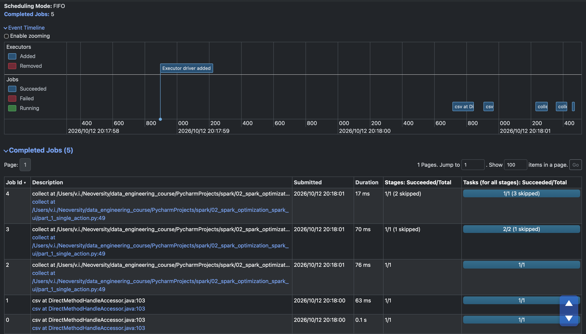
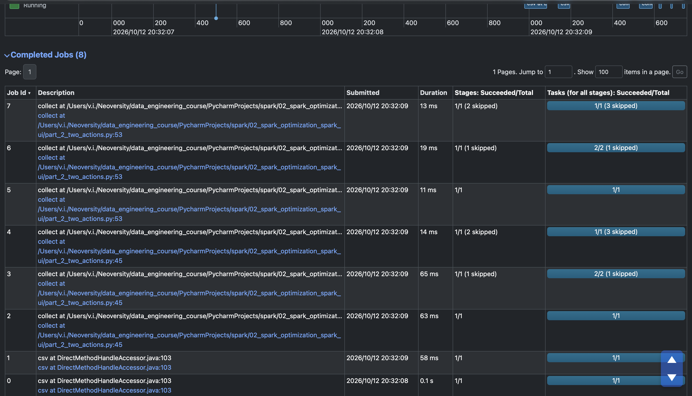
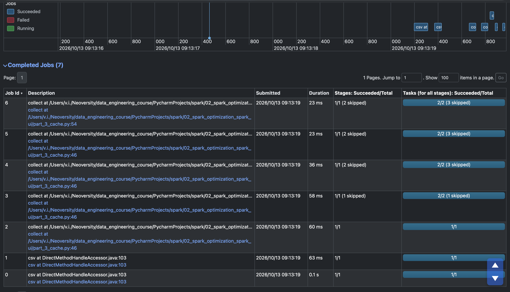

# Spark Optimization and SparkUI

A practical Apache Spark project completed as **Homework 04** of the GoIT Neoversity Data Engineering course.

The purpose of this project is to explore Spark execution behavior using **SparkUI**, with a focus on lazy evaluation, Actions, Jobs, shuffle operations, and DataFrame caching.

## Technologies

- Python
- Apache Spark
- PySpark
- SparkUI

## Experiment

The same Spark processing pipeline was executed in three different variants:

1. A single final `collect()` action.
2. Two `collect()` actions without caching.
3. Two `collect()` actions with an intermediate DataFrame cached using `cache()`.

The number of Jobs produced by each version was then compared in SparkUI.

---

## Part 1 — Single Action

The first version contains one final `collect()` action.

The additional:

```python
nuek_processed = nuek_processed.where("count > 2")
```

is a transformation and is evaluated lazily. It does not trigger Spark execution by itself.

Execution starts when:

```python
nuek_processed.collect()
```

is called.

**Result: 5 completed Jobs.**



In this execution:

- the initial Jobs are related to reading the CSV file and schema inference;
- the final action triggers execution of the transformation pipeline;
- shuffle operations caused by `repartition()` and `groupBy()` divide the execution into multiple stages and Jobs.

---

## Part 2 — Two Actions Without Cache

The second version adds an intermediate action:

```python
nuek_processed.collect()
```

before applying the final filter.

The pipeline therefore contains two Actions:

```python
nuek_processed.collect()

nuek_processed = nuek_processed.where("count > 2")

nuek_processed.collect()
```

**Result: 8 completed Jobs.**



The first `collect()` triggers execution of the DataFrame lineage.

Because the intermediate DataFrame is not cached, the second `collect()` requires Spark to recompute part of the previous lineage.

As a result, additional Jobs are created.

---

## Part 3 — Two Actions With Cache

The third version caches the intermediate DataFrame:

```python
nuek_processed_cached = (
    nuek_repart
    .where("final_priority < 3")
    .select("unit_id", "final_priority")
    .groupBy("unit_id")
    .count()
    .cache()
)
```

The first `collect()` computes the DataFrame and materializes the cache.

The second action can then reuse the cached intermediate result instead of recomputing the complete lineage.

**Result: 7 completed Jobs.**



This demonstrates how caching can reduce repeated computation when the same intermediate DataFrame is reused by multiple Actions.

After the cached data is no longer required, it is released using:

```python
nuek_processed_cached.unpersist()
```

---

## Results

| Version | Actions | Cache | Completed Jobs |
|---|---:|---|---:|
| Part 1 | 1 | No | 5 |
| Part 2 | 2 | No | 8 |
| Part 3 | 2 | Yes | 7 |

## Key Takeaways

- Spark transformations are evaluated lazily.
- Actions such as `collect()` trigger execution.
- Multiple Actions can cause the same DataFrame lineage to be recomputed.
- `cache()` does not immediately execute the DataFrame; the cache is materialized by an Action.
- Cached intermediate results can be reused by later Actions.
- Caching is useful when an expensive intermediate DataFrame is used multiple times.
- `unpersist()` releases cached data when it is no longer needed.
- SparkUI makes Jobs, Stages, Tasks, shuffle operations, and repeated computation visible.
